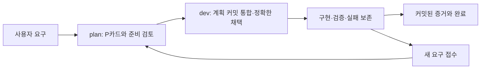

# plan-dev-harness

**Codex와 Claude Code에서 함께 사용하는 설치형 기획·개발 하네스.**
Git worktree로 plan/dev를 분리하고, 준비된 P카드와 정확한 계획 커밋을 기준으로 개발합니다.
새 요구 접수부터 검증 증거·완료 처리까지 파일로 남겨 도구를 바꿔도 같은 작업을 이어갈 수 있습니다.

Python 표준 라이브러리 + Git만 사용합니다. 계정 토큰, API 키, MCP 서버, 유료 모델 호출이 설치에 필요하지 않습니다.
이 브랜치의 구현 버전: **0.2.0 / MIT**. 릴리스 상태는 GitHub Releases를 확인하세요. Python **3.9 이상**, Git **2.31 이상**, POSIX shell 환경을 대상으로 합니다.
macOS에서 실제 검증했습니다. Linux/WSL 사용 절차는 같지만 이 릴리스에서 직접 검증하지 않았고,
네이티브 Windows 지원은 확인하지 않았습니다. 모델이 모든 규칙을 준수한다고 보장하는 도구는 아닙니다.



## 빠른 시작: 새 프로젝트

```sh
git clone https://github.com/milkpotato1000/plan-dev-harness.git
cd plan-dev-harness
python3 scripts/bootstrap_workspace.py --parent "$HOME/projects" --name demo
# 출력 경로를 확인한 뒤 적용 (parent는 먼저 존재해야 합니다)
python3 scripts/bootstrap_workspace.py --parent "$HOME/projects" --name demo --apply
```

설정된 Git 이름/이메일을 사용합니다. 없으면 명령이 중단되며
`--author-name 'Your Name' --author-email 'you@example.com'`으로 새 저장소에만 지정할 수 있습니다.
기존 global identity나 hook 설정은 바꾸지 않습니다. 기존 목적지 또는 상위 Git 저장소 안에는 생성하지 않습니다.

```text
demo/                       # 두 도구에서 여는 단일 workspace, Git 저장소 아님
  AGENTS.md                 # 공통 역할/경로 안내
  CLAUDE.md                 # @AGENTS.md
  demo_main/                # 초기 인프라 기준선; 실제 Git 디렉터리
  demo_plan/                # 기획/계약/P카드, linked worktree
  demo_dev/                 # 채택한 구현/검증, linked worktree
```

생성기는 인프라 초기 커밋 → plan/dev worktree → dev의 정확한 계획 채택 → 로컬 Git 훅 활성화까지 수행합니다.
제품 큐는 비워 두며 원격 저장소·push·채팅·제품 구현을 자동 생성하지 않습니다.
처음부터 존재하는 폴더는 덮어쓰지 않습니다. 실패 시 부분 생성물도 삭제하지 않고 남깁니다.

## Codex / Claude Code 스킬 설치 (선택)

저장소 하네스는 스킬 없이도 동작합니다. 에이전트에게 재사용 가능한 설치 절차를 제공하려면:

```sh
# 미리보기; 적용할 때 같은 명령에 --apply 추가
python3 scripts/install_skill.py --agent codex
python3 scripts/install_skill.py --agent claude
```

| 도구 | 개인 스킬 위치 | 프로젝트 규칙 |
| --- | --- | --- |
| Codex | `~/.agents/skills/plan-dev-harness/` | `AGENTS.md` |
| Claude Code | `~/.claude/skills/plan-dev-harness/` | `CLAUDE.md`에서 `@AGENTS.md` |

프로젝트 한정 설치는 `--skills-dir /absolute/project/.agents/skills` 또는
`--skills-dir /absolute/project/.claude/skills`로 지정합니다. 스크립트·템플릿까지 독립 복사하므로
원본 배포 저장소를 옮겨도 설치된 스킬은 실행할 수 있습니다. 기존의 다른 버전/수정된 스킬은 보존하고 중단합니다.
이 릴리스는 **Git에서 설치하는 공통 스킬 + CLI**이며 각 앱의 마켓플레이스 플러그인 등록은 포함하지 않습니다.

Codex에서는 `$plan-dev-harness`, Claude Code에서는 `/plan-dev-harness`로 요청할 수 있습니다.
새 세션에서 스킬/프로젝트 규칙을 읽었는지 확인하세요. 도구별 권한·sandbox·조직 정책은 별도로 적용됩니다.

## 기존 프로젝트에 설치

활성 writer와 기존 hook을 확인한 뒤 **plan worktree**에서 설치합니다.
기존 instruction 파일이 다르면 먼저 읽고 병합합니다. 설치기는 자동 덮어쓰기하지 않습니다.

```sh
python3 scripts/install_harness.py --repo /absolute/project_plan \
  --plan-branch plan --dev-branch dev --release-branch main \
  --protect docs/planning --protect docs/architecture --agent both
# 검토 후 같은 명령에 --apply 추가
```

`--agent both`는 공통 AGENTS.md·CLAUDE.md·workflow를 설치합니다. 이미 관리 중인 지침이 있다면
`--agent none`으로 코어를 설치하고 [공통 규칙](assets/instructions/agent-workflow.md)을 수동 병합하세요.
기존 Git hooksPath나 hook과 충돌하면 기존 시스템을 보존하고 통합 여부를 먼저 결정합니다.
보호할 실제 계약 경로만 `--protect`로 지정하세요. `.harness` 전체를 보호하면 dev의 채택 파일까지
막으므로 거부합니다. 설치 명령은 파일만 쓰며 커밋·Git 설정·worktree·채택·승격을 하지 않습니다.

[설치 후 통합/채택/활성화](references/usage.md)를 수행해야 dev 보호가 활성화됩니다.
모든 참여 worktree에 스크립트가 있어야 하고, 별도 clone에는 hook 설치를 다시 해야 합니다.

## 일상 사용

- plan: “다음 작업 기획해줘.” — 계약·검증·완료 조건을 준비해 P카드를 등록합니다.
- dev: “다음 큐 진행해줘.” — 준비되고 선행이 충족된 채택 범위만 개발합니다.
- dev 새 기능 요청: 접수 기록 → plan 검토 → P카드 준비 → 정확한 채택 후 구현합니다.
- 완료: 실패 기록을 보존하면서 각 체크의 최신 PASS와 커밋된 증거를 남깁니다.
- main 승격·push·외부 메시지는 프로젝트별 사용자 권한을 따릅니다.

```sh
# 해당 worktree에서
python3 scripts/work_queue.py --owner all
python3 scripts/contract_guard.py check
python3 scripts/plan_intake.py list
```

plan은 dev의 커밋된 진척을 조회합니다. 조회는 fetch/merge/실행하지 않습니다.
원격 동기화는 사용자의 프로젝트 권한 안에서 별도로 수행하세요.
Codex plan ↔ Claude Code dev 또는 반대 조합도 같은 Git 계약을 사용합니다.
한 worktree에는 한 writer만 사용하고 채팅 간 자동 메시지 전송은 가정하지 않습니다.

## 결정 대기 · 사용자 중지 · 인계

| 상황 | 처리 |
| --- | --- |
| 다음에 만들 새 기능 | intake로 접수. 관계없는 기존 승인 작업은 계속 |
| 현재 작업에 필요한 판단 미정 | 결정 요청. plan이 영향 범위를 정하고 관련 작업/의존 작업 차단 |
| 영향 범위를 아직 모름 | 안전한 범위가 확인될 때까지 dev 전체 선택 중지 |
| 사용자가 중지 요청 | 기본 양쪽 역할 중지. 명시적으로 현재 역할만 멈출 수도 있음 |
| 결정이 해결됨 | 결정 plan을 채택한 뒤 해결 기록. 사용자 중지는 별도로 유지 |
| 다른 세션에 인계 | 커밋 문서를 연결하고 전달 대기/전달 확인/수신 확인을 구분 |

```sh
# 현재 plan/dev worktree에서 실제 사용자 요청을 근거로 기록
python3 scripts/workflow_control.py pause --request '사용자 중지 요청 참조'
python3 scripts/workflow_control.py resume --request '사용자 명시적 재개 요청 참조'
python3 scripts/work_queue.py --owner all --json
```

[결정 요청·분류·해결·인계 명령](assets/docs/process/workflow-controls.md)을 확인하세요.
기존 Markdown OPEN/RESOLVED와 PAUSED/ACTIVE 기록도 읽습니다. 범위 없는 과거 기록은 전체 차단으로
해석합니다. 잘못된 기록/축약 SHA를 무시하거나 자동 수정하지 않습니다. 일반 intake와 함께 사용합니다.
큐는 상대의 커밋된 기록을 읽으며 자동 fetch/메시지 전송/프로세스 강제 중단은 하지 않습니다.

Asana·서비스별 버전 승인·호스트 메시징은 [선택 확장 계약](assets/docs/process/optional-adapters.md)으로
분리합니다. 이 릴리스에 외부 서비스 연결기나 자동 플러그인 로더가 구현됐다는 뜻은 아닙니다.

## 업그레이드와 복구

1. 새 배포 버전의 변경 이력과 diff를 확인합니다.
2. plan에서 기존과 동일 옵션 + `--upgrade`로 미리봅니다.
3. `.harness/installation.json`의 이전 hash와 일치하는 관리 파일만 `--apply`로 교체합니다.
4. 검토·커밋 후 dev 통합·정확한 재채택·회귀를 수행합니다.

v0.1.0 manifest가 있는 설치는 동일 옵션으로 v0.2.0 업그레이드를 미리볼 수 있습니다.
추가 스크립트/문서는 설치하지만 기존 checkpoint·요청·인계 기록과 사용자 추가 post 훅은 보존합니다.
새 plan 소유 경로(`docs/planning/decision-scopes`, plan checkpoint/인계)가 보호 목록에 추가됩니다.
업그레이드 뒤 기존 기록이 새 검사에 실패하면 실제 근거를 검토해 수정하며 우회용 삭제는 하지 않습니다.
사용자 수정 파일, 다른 옵션/브랜치 구성, manifest 없는 옛 설치는 자동 업그레이드하지 않습니다.
이 경우 템플릿과 기존 파일을 비교해 수동 병합합니다. 기존 P카드·로그·요청·채택 기록은 설치 대상이 아닙니다.
스킬 업그레이드는 기존 스킬을 별도 위치에 보존하고 새 버전을 검토해 설치합니다. 무차별 삭제/강제 덮어쓰기는 없습니다.
이전 커밋으로 돌아갈 때도 현재 작업을 버리지 말고 plan에서 필요한 변경을 검토해 revert한 뒤 dev에 전달합니다.

## 검증과 한계

```sh
python3 -m unittest discover -s tests -v
```

실제 임시 Git 저장소에서 보호된 계약 수정 거부, P카드 완료 증거, 정확한 SHA 채택,
변경 요청 불변성, 원격 dev 진척 조회, 설치/업그레이드 충돌, 두 에이전트 스킬 배치,
새 workspace 및 기존 workspace 이동을 검사합니다. [v0.2.0 검증 기록](docs/verification-v0.2.0.md) · [v0.1.0 기록](docs/verification.md)과
[호환성](docs/compatibility.md)을 확인하세요. 자동 에이전트가 실제 제품 기능을 구현하는 모델 E2E 테스트와는 다릅니다.

Git 훅은 우회 가능한 로컬 검사입니다. 대화의 의미나 모든 코드 diff를 자동 분류하지 않으며,
보안 경계·원격 브랜치 보호·완전한 작업 범위 증명을 대신하지 않습니다. CI/PR 강제는 선택 사항입니다.

- [워크플로 명령](references/usage.md)
- [P카드/큐](assets/docs/process/work-queue.md)
- [새 요구 접수](assets/docs/process/plan-intake.md)
- [레거시 폴더 이동](references/workspace-layout.md)
- [변경 이력](CHANGELOG.md)

## 승인된 직접 인계와 설치본 전환

[직접 인계 절차](references/direct-handoff.md)는 인간의 현재 지시/범위가 일치하는 기존 위임과
실제 호스트 도구가 있으면 수신자를 확인하고 커밋된 계획을 직접 전달하도록 안내합니다.
초기 채팅 생성이나 다른 에이전트의 메시지만으로 발송 권한을 만들지 않습니다.
전송 성공(SENT), 실제 응답 확인(ACK), 정확한 채택과 완료는 각각 별도 근거를 남깁니다.
권한/도구 부재·대상 불명·전송 불명은 파일 인계와 상태 확인으로 처리하며 중지는 유지합니다.

소스 assets 변경과 프로젝트 설치 갱신, 개인 스킬 활성화는 별개입니다.
[설치·전환 안내와 기존 기능](references/usage.md)을 확인하세요. 프로젝트의 --upgrade와 달리
install_skill.py에는 --upgrade가 없습니다. Codex 기본 ~/.agents/skills와 구형 ~/.codex/skills를
구분하고, 기존 설치를 보존한 새 목적지 검증 후 실제 로드 경로를 확인합니다.
